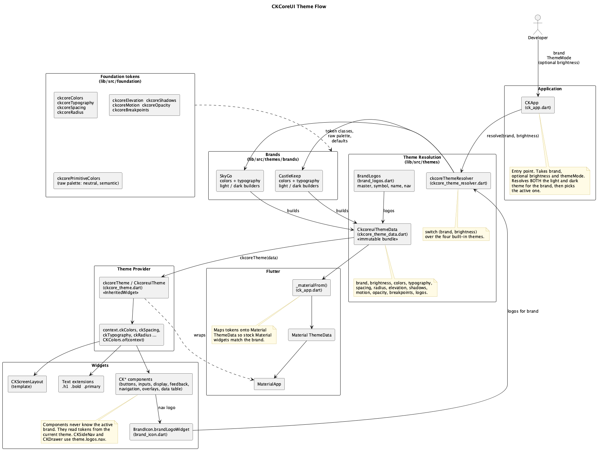

# Architecture

> **Audience:** developers who maintain or extend `ckcoreui`. App developers should start with [Getting started](getting-started/README.md).

## TL;DR

**What it is.** A Flutter design-system package (`ckcoreui` on pub.dev, repo `ckgoc_core`): two brands (CastleKeep, SkyGo) x light/dark, design tokens, and about 52 `CK*` widgets. It is presentation only: no backend, no database, no network calls. Runtime dependencies are `flutter_svg` and `lucide_icons_flutter`.

**One idea to remember.** `CKApp` resolves a *brand + brightness* into one immutable `CkcoreuiThemeData` (all tokens plus logos) and puts it in an `InheritedWidget`. Every widget reads tokens from `BuildContext` (`context.ckColors.primary`); nothing is hard-wired to a brand.

### Repo at a glance

```
ckgoc_core/
├── lib/
│   ├── ckcoreui.dart            # public entry (re-exports ckcore_core.dart)
│   ├── ckcore_core.dart         # barrel: app, themes, foundation, components, templates, lucide icons
│   └── src/
│       ├── app/                 # CKApp (MaterialApp wrapper), deprecated ckcoreApp
│       ├── foundation/          # tokens: colors, typography, spacing, radius, elevation, shadows,
│       │                        #   motion, opacity, breakpoints + Text extensions (.h1, .bold, ...)
│       ├── themes/              # ckcoreBrand, CkcoreuiThemeData, resolver, BrandLogos, BrandIcon,
│       │   └── brands/          #   castlekeep/ and skygo/ (colors, typography, light + dark builders)
│       ├── components/          # buttons/ inputs/ display/ feedback/ navigation/ overlays/ data_table/
│       │                        #   + component_enums.dart (enums and small model classes)
│       └── templates/           # CKScreenLayout (responsive side-nav shell)
├── assets/                      # Inter fonts, brand logos (images/logos/ck, images/logos/skygo)
├── bin/ckgoc.dart               # CLI: `add brand` scaffolding
├── test/                        # unit + widget tests (components/, foundation/, app/, cli/, mcp/)
├── example/                     # small showcase app (one screen per component group)
├── doc/
│   ├── getting-started/         # developer guides (this folder's siblings)
│   ├── architecture.md          # you are here
│   ├── CORE/, foundation/       # design-team docs: the source of truth for token values (read-only for devs)
│   └── flutter_docs/            # interactive docs site (Flutter web) deployed to GitHub Pages
├── mcp/                         # MCP server (TypeScript) published separately to npm as @ckcore/ui-mcp
├── skills/                      # Claude Code skill + Copilot instructions
├── tools/normalize_logos.sh     # renames logo assets to the naming convention
└── .github/workflows/           # ci.yml, flutter-docs.yml, publish-mcp.yml
```

### How it is designed

- **Layers depend downwards only:** `foundation` (tokens) -> `themes` (brand x brightness) -> `app` (`CKApp`) -> `components` -> `templates`. Components never import a brand; they only read the theme.
- **Theme = data class + resolver.** `ckcoreThemeResolver.resolve(brand, brightness)` is a switch over the four built-in combinations. Each brand folder builds a `ckcoreThemeData` from its own palette and typography.
- **Variants are named constructors and enums**, not subclasses: `CKButton.outline`, `CKAlert.error`, `ButtonSize.lg`. Shared enums and small model classes (`CKTab`, `CKStep`, ...) live in `components/component_enums.dart`.
- **Mostly presentational.** Widgets take data and emit callbacks. A few keep local UI state (dropdown/date-picker overlays, `CKDataTable` in-memory sorting when `onSortChanged` is omitted).
- **Overlays use `OverlayEntry`** (dropdown, date picker, popover, side nav, snackbar, column filters), managed by each widget.
- **Tooling lives next to the package** but is excluded from pub.dev (`.pubignore`): the MCP server, skills, tests, scratch apps.

### Widgets covered (65 knowledge entries; every public `CK*` class)

- **App** (1): `CKApp`
- **Layout** (1): `CKScreenLayout`
- **Buttons** (3): `CKButton`, `CKIconButton`, `CKFab`
- **Inputs** (11): `CKTextField`, `CKPasswordField`, `CKSearchField`, `CKCheckbox`, `CKSwitch`, `CKDropdown`, `CKDatePicker`, `CKTimePicker`, `CKNumberStepper`, `CKOtpField`, `CKRadio`
- **Display** (13): `CKAvatar`, `CKBadge`, `CKCard`, `CKAnimate`, `CKAccordion`, `CKStepper`, `CKTimeline`, `CKListTile`, `CKDivider`, `CKContainer`, `CKFilterChip`, `CKInputChip`, `CKAvatarGroup`
- **Feedback** (10): `CKAlert`, `CKToast`, `CKSnackbar`, `CKLoadingState`, `CKLoader`, `CKProgressBar`, `CKSlider`, `CKSkeleton`, `CKEmptyState`, `CKErrorState`
- **Navigation** (7): `CKTabs`, `CKBreadcrumb`, `CKAppBar`, `CKBottomNavigation`, `CKNavigationRail`, `CKDrawer`, `CKSideNav`
- **Overlays** (5): `CKDialog`, `CKMenu`, `CKPopover`, `CKTooltip`, `CKBottomSheet`
- **Data Table** (1): `CKDataTable`

Model/helper classes used by those widgets: `CKAccordionItem`, `CKStep`, `CKTimelineEvent`, `CKMenuItem`, `CKTab`, `BreadcrumbItem`, `CKNavItem`, `CKDrawerItem`, `CKSideNavSection`, `CKSideNavItem`, `CKTableColumn`, `CKEditableCell`, `CKTableFilter`.

### Developer Q&A

**How do I run things?**
`flutter pub get`, then `flutter analyze --no-fatal-infos` and `flutter test` (the suite includes a CLI test that runs `flutter analyze` on a scaffolded copy, so it takes about a minute). Docs site: `cd doc/flutter_docs && flutter run -d chrome`. Example: `cd example && flutter run -d chrome`. MCP server: `cd mcp && npm ci && npm run build && npm run smoke`.

**How does a token reach a widget?**
`CKApp.build` resolves the theme for the brand, wraps `MaterialApp` in `ckcoreTheme(data: ...)` (an `InheritedWidget`), and also maps tokens onto Material's `ThemeData` so stock Material widgets look right. `context.ckColors` -> `CKColors.of(context)` -> `CkcoreuiTheme.of(context)`. Widgets above `CKApp` cannot read the theme.

**How do I add a component?**
1. Create `lib/src/components/<group>/ckcore_<name>.dart`; read tokens via `context.ckcoreTheme` (no literals where a token exists). Put new enums/models in `component_enums.dart`.
2. Export it from the group barrel (for example `inputs/inputs.dart`).
3. Add tests: put a builder in a `smokeMatrix({...})` call (renders it under all four brand/brightness combinations) and add behaviour tests with `pumpCK`.
4. Add an entry to `mcp/src/knowledge/components.json`. `test/mcp/knowledge_sync_test.dart` fails until every public `CK*` class has one.
5. Add a docs-site page or section (`doc/flutter_docs/lib/pages/`, route in `lib/main.dart`, `lib/docs/doc_widgets.dart` and `lib/docs/docs_sidebar.dart`) and optionally an example screen.
6. Add a line to `CHANGELOG.md`.

**How do I add a brand?**
See [Brands](getting-started/brands.md#adding-a-new-brand): enum value + `displayName`, four files under `themes/brands/<name>/`, a resolver case, optional `logos`. The CLI (`dart run bin/ckgoc.dart add brand "Acme"`) does the mechanical part and `test/cli/add_brand_test.dart` checks it still produces code that analyzes.

**How do I add or change a token?**
Edit the class in `lib/src/foundation/<family>/` (field, default, `copyWith`). Colours are required constructor fields of `ckcoreColors`, so a new colour must be set in all four theme builders and in the CLI templates in `bin/ckgoc.dart`. Then update `mcp/src/knowledge/tokens.json` (code names) and, if the design value changed, its `designSpec` section. Token *values* are decided by the design team: see section 7.

**Why are there so many names (`CK*`, `ckcore*`, `Ckcoreui*`, `Ckgoc*`)?**
History. Public widgets are `CK*`; token and brand types are lowercase `ckcore*` (for example `ckcoreBrand`, `ckcoreColors`); `CkcoreuiTheme` and `CkcoreuiThemeData` are the underlying classes with `ckcoreTheme` / `ckcoreThemeData` aliases; `CkgocBrand` and `CkgocApp` are deprecated aliases from the old name. The repo is `ckgoc_core`, the package `ckcoreui`. Renaming would be a breaking change, so it is tracked as debt in [audit.md](../audit.md).

**What is deprecated?**
`ckcoreApp` (use `CKApp`), `CKDataTable.editableColumns` / `onCellChanged` (use `editableCells` / `onCellValueChanged`), `CKSideNav` `selectedIndex` / `onItemSelected` (prefer `selectedKey` / `onItemSelectedKey`; the old pair is still required). `CKApp.responsive` is accepted but unused.

**How is it released?**
- *Package:* bump `version` in `pubspec.yaml`, update `CHANGELOG.md`, run `flutter pub publish --dry-run`, then publish to pub.dev by hand. No workflow publishes it.
- *Docs site:* any push to `main` that touches `lib/`, `assets/`, `pubspec.*` or `doc/flutter_docs/` rebuilds and deploys it to GitHub Pages (`flutter-docs.yml`).
- *MCP server:* bump `mcp/package.json` and the version string in `mcp/src/index.ts`, then push a tag `mcp-vX.Y.Z`; `publish-mcp.yml` builds, runs the smoke test and publishes to npm. Versions are permanent.

**What runs in CI?**
`ci.yml` on pull requests: `flutter analyze --no-fatal-infos`, `flutter test`, and the MCP build + `npm run smoke` (calls all 8 tools). Errors and warnings fail the build; the existing deprecation infos do not.

**Where do I look when X breaks?**
Theme not found -> the widget is above `CKApp`. Logo missing -> `BrandLogos` on that brand's theme builders, and `package: 'ckcoreui'` on `Image.asset`. MCP tool answers "not found" -> `mcp/src/knowledge/*.json` and `npm run smoke`. Style wrong in one brand only -> that brand's `*_light_theme.dart` / `*_dark_theme.dart`.

**Can I edit `doc/CORE` or `doc/foundation`?**
No. They come from the design team and are the source of truth for token values. Code changes that disagree with them should be raised with design, not "fixed" in those files.

---

## Detail

### 1. Layers and the public surface

```
foundation  ->  themes  ->  app (CKApp)  ->  components  ->  templates
 tokens        brand x         theme in        read tokens       CKScreenLayout
               brightness      InheritedWidget  from context
```

`lib/ckcore_core.dart` exports `app`, `themes`, `foundation`, `components`, `templates` and `lucide_icons_flutter`. `lib/ckcoreui.dart` re-exports it so both `package:ckcoreui/ckcoreui.dart` and `.../ckcore_core.dart` work. Everything under `lib/src/` is private by convention; inside the package, files import each other with `package:ckcoreui/src/...` (the `always_use_package_imports` lint).

### 2. Theme flow

1. The app passes `brand` (and optionally `brightness`) to `CKApp`.
2. `CKApp` resolves *both* the light and dark `ckcoreThemeData` for the brand via `ckcoreThemeResolver` and picks the active one from `brightness` / `themeMode` / platform brightness.
3. It builds a `MaterialApp` (or `.router`) whose `theme` / `darkTheme` are derived from the same tokens (`_materialFrom`), wrapped in `ckcoreTheme(data: active)`.
4. Components call `context.ckcoreTheme` (or `context.ckColors` and friends) and style themselves from tokens. Subtrees can override with `ckcoreTheme(data: ckcoreTheme.of(context).copyWith(...))`.



Source: [`architecture_theme.puml`](architecture_theme.puml). Re-render after editing with `plantuml -tpng -nometadata doc/architecture_theme.puml` (needs Java and Graphviz).

`ckcoreThemeData` carries: `brand`, `brightness`, `colors`, `typography`, `spacing`, `radius`, `elevation`, `shadows`, `motion`, `opacity`, `breakpoints`, and `logos` (`BrandLogos`: `master`, `symbol`, `name`, `nav` asset paths, default `BrandLogos.none`).

### 3. Brands and logos

A brand is: an enum value, a palette (`<name>_colors.dart`), a type scale (`<name>_typography.dart`), and light/dark builders that map the palette onto the semantic colour roles. Logos are declared on the theme, so `BrandIcon.brandLogoWidget`, `CKSideNav` and `CKDrawer` need no per-brand code. The only `switch` statements over `ckcoreBrand` are the resolver and `displayName`.

### 4. Component conventions

- Constructors are `const`; required parameters first (`always_put_required_named_parameters_first`); single quotes and trailing commas (see `analysis_options.yaml`).
- No colour, spacing or radius literals when a token exists; motion respects reduced-motion (`MediaQuery.disableAnimations`).
- Variants: named constructors for the common ones, an enum for the rest.
- `Text` helpers in `foundation/text_extensions.dart`: modifiers (`.bold`) return `Text`; style and colour helpers (`.h1`, `.primary`) return `Widget` because they need the theme, so they must come last.

### 5. Tooling around the package

| Piece | Where | Notes |
| --- | --- | --- |
| Scaffolding CLI | `bin/ckgoc.dart` | Textual edits to `ckcore_brand.dart` and the resolver; works inside a clone of this repo only |
| MCP server | `mcp/` | 8 lookup tools over hand-maintained JSON in `mcp/src/knowledge/`; stdio; `npm run smoke` exercises every tool |
| Skills | `skills/` | `ckcoreui/SKILL.md` (Claude Code) and `copilot-instructions.md` (Copilot) |
| Docs site | `doc/flutter_docs/` | Flutter web app that depends on the package by path; pages in `lib/pages/`, routes in `lib/main.dart` |
| Example | `example/` | Path-depends on the package; used for manual checks |
| Logo tool | `tools/normalize_logos.sh` | Renames assets to the naming convention (uses `git mv`) |

### 6. Tests

- `test/helpers/test_app.dart`: `pumpCK` (mounts a widget inside `CKApp` on a large surface) and `smokeMatrix` (builds each widget under the four brand/brightness combinations and asserts nothing throws).
- `test/components/*`: behaviour tests per component group. `test/foundation/*`: theme, text extensions, brand icons and logos. `test/app/*`: `CKApp`.
- `test/cli/add_brand_test.dart`: scaffolds a brand in a temp copy and runs `flutter analyze` on it.
- `test/mcp/knowledge_sync_test.dart`: keeps `components.json` in step with the library.

### 7. Source of truth and known differences

- **Token values and design rationale:** `doc/CORE/` and `doc/foundation/` (design team, read-only).
- **Token names that exist in code:** `lib/src/foundation/`. The getting-started guides and the MCP `tokens.json` use these names, so generated code compiles.
- **Design values in the MCP server:** `tokens.json` also carries a `designSpec` section (query it with `getTokens designSpec`): the design team's colours, typography table, spacing and grid, each mapped to the code token and marked `exact`, `sizeOnly` or `none`.

The design docs and the code currently differ in places. These are for the design and dev teams to reconcile, not to patch in either side silently:

| Design doc | Says | Code has |
| --- | --- | --- |
| `foundation/typography.md` | tokens `displayXl` 56 ... `headingXl`, `bodyMd`, `codeSm`; `Text(...).h1.primary` | `display2xl` 32 ... `displaySm`, `textXl` ... `textXs`, `labelXl` ... `labelSm`, `codeMd`; no `heading*`, `body*` or `codeSm`; `.h1.primary` does not compile |
| `foundation/typography.md` | `context.ckcoreTheme.typography.headingLg`; fonts in `assets/fonts/<brand>/` | no `headingLg`; one shared family in `assets/fonts/Inter/` |
| `foundation/spacing.md` | `2xl`, `3xl`, `4xl`, `5xl` | `x2l` ... `x5l`, plus `none`, `s12`, `s20`, `s40`, `s80` |
| `foundation/colors.md` | `surfaceVariant` is the table row stripe | row stripes use `background`; `surfaceVariant` is the table header/footer |
| `CORE/overview_design_system.md` | component library `shadcn_flutter`; Login/Register/Settings templates | no such dependency; only `CKScreenLayout` (the other templates were removed in 0.6.0) |
| `CORE/brand_logos_constants.md` | `BrandIconWidget(...)` helper | no such class; use `BrandIcon.brandLogoWidget` |
| `CORE/color.md` | `lib/theme/app_colors.dart` with `CastlekeepColors`, `SkygoColors`, `AppColors` | `CastleKeepColors` / `SkyGoColors` in `lib/src/themes/brands/<brand>/`, neutrals in `ckcorePrimitiveColors` |
| `CORE/spacing_and_grid.md` | grid of 4/8/12 columns, gutters and margins | not implemented in code |

### 8. Known debt

Naming split (section "Developer Q&A"), a few very large widget files (`ckcore_date_picker.dart`, `ck_app.dart`, `ckcore_data_table.dart`, `ckcore_side_nav.dart`), unused `CKApp.responsive`, the example app still using deprecated APIs, and an MCP package whose fixes need a new npm release. The full audit with ratings and tasks is in [audit.md](../audit.md).

---

## Component catalog

| Component | Group | What it is |
| --- | --- | --- |
| `CKApp` | App | Drop-in replacement for MaterialApp that applies the brand theme. |
| `CKScreenLayout` | Layout | Responsive shell: persistent side nav at >= 840px; below that the side nav is hidden and opens as an overlay from a hamburger menu. |
| `CKButton` | Buttons | Primary button component with semantic color variants and size options |
| `CKIconButton` | Buttons | Icon-only button component |
| `CKFab` | Buttons | Floating Action Button component |
| `CKTextField` | Inputs | Text field with validation, helper and success states |
| `CKPasswordField` | Inputs | Password field with visibility toggle |
| `CKSearchField` | Inputs | Search field optimized for search queries |
| `CKCheckbox` | Inputs | Checkbox with optional label and status variants |
| `CKSwitch` | Inputs | Toggle switch component |
| `CKDropdown` | Inputs | Dropdown/select component with menu overlay |
| `CKDatePicker` | Inputs | Date picker with calendar overlay |
| `CKTimePicker` | Inputs | Time picker component |
| `CKNumberStepper` | Inputs | Integer input with increment and decrement buttons, styled like CKTextField. |
| `CKOtpField` | Inputs | One-time-password input shown as fixed-width cells; numeric only. |
| `CKRadio` | Inputs | Radio control with optional label; generic over the value type. |
| `CKAvatar` | Display | Circular/square avatar with initials, image, and status indicator |
| `CKBadge` | Display | Badge component for labels, counts, and status indicators |
| `CKCard` | Display | Card container with optional media, title, description, and action |
| `CKAnimate` | Display | Entrance-animation wrapper. |
| `CKAccordion` | Display | Expandable sections; one open at a time unless allowMultiple. |
| `CKStepper` | Display | Step-by-step progress indicator, vertical or horizontal. |
| `CKTimeline` | Display | Vertical or horizontal timeline of events. |
| `CKListTile` | Display | List row with optional leading, subtitle and trailing widgets. |
| `CKDivider` | Display | Thin separator line, horizontal by default. |
| `CKContainer` | Display | Surface container with design-system background, border and padding. |
| `CKFilterChip` | Display | Selectable chip for filters. |
| `CKInputChip` | Display | Chip with a remove button, for entered values or tags. |
| `CKAvatarGroup` | Display | Overlapping group of CKAvatar widgets with a +N overflow. |
| `CKAlert` | Feedback | Inline message with semantic variants and optional dismiss. |
| `CKToast` | Feedback | Toast notification widget with semantic variants. |
| `CKSnackbar` | Feedback | Shows a CKToast as transient feedback, by default floating at the top of the window. |
| `CKLoadingState` | Feedback | Centered loader with an optional message. |
| `CKLoader` | Feedback | Spinner with several animation styles. |
| `CKProgressBar` | Feedback | Progress bar. |
| `CKSlider` | Feedback | Slider bound to a double value. |
| `CKSkeleton` | Feedback | Placeholder block with a gentle pulse while content loads (skipped under reduced motion). |
| `CKEmptyState` | Feedback | Centered message for a list, table or page with nothing to show. |
| `CKErrorState` | Feedback | Centered message for something that failed to load; shows a retry button when onRetry is set. |
| `CKTabs` | Navigation | Tabs with line (default), pill or card style. |
| `CKBreadcrumb` | Navigation | Breadcrumb trail. |
| `CKAppBar` | Navigation | App bar for Scaffold.appBar; primary (brand) background by default. |
| `CKBottomNavigation` | Navigation | Bottom navigation bar for phones. |
| `CKNavigationRail` | Navigation | Vertical navigation rail for tablet and desktop. |
| `CKDrawer` | Navigation | App drawer (Scaffold.drawer) with app name, optional user email and items. |
| `CKSideNav` | Navigation | Collapsible side navigation with sections, badges, branding and a profile card. |
| `CKDialog` | Overlays | Modal dialog with title, content, and action buttons |
| `CKMenu` | Overlays | Menu opened from a trigger widget. |
| `CKPopover` | Overlays | Panel anchored below a trigger; tapping the trigger toggles it. |
| `CKTooltip` | Overlays | Tooltip on hover or long-press. |
| `CKBottomSheet` | Overlays | Bottom sheet following the design-system surface and spacing. |
| `CKDataTable` | Data Table | Advanced data table with sorting, filtering, pagination, and inline editing |

Props, variants and usage snippets for each are in `mcp/src/knowledge/components.json` (queryable through the MCP server) and, with live demos, in the docs site.
